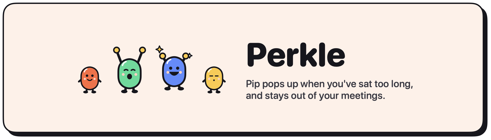
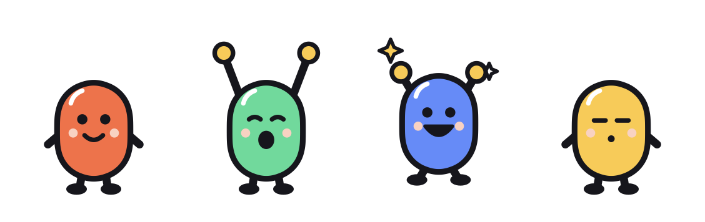
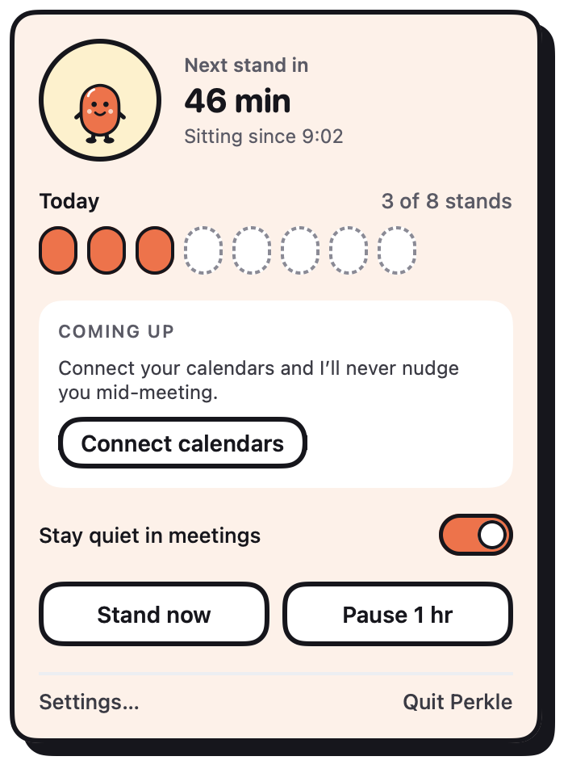
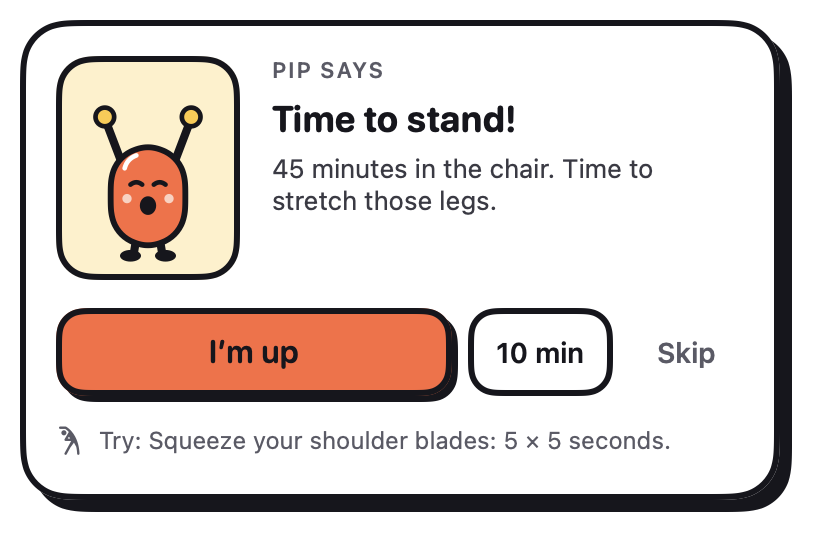
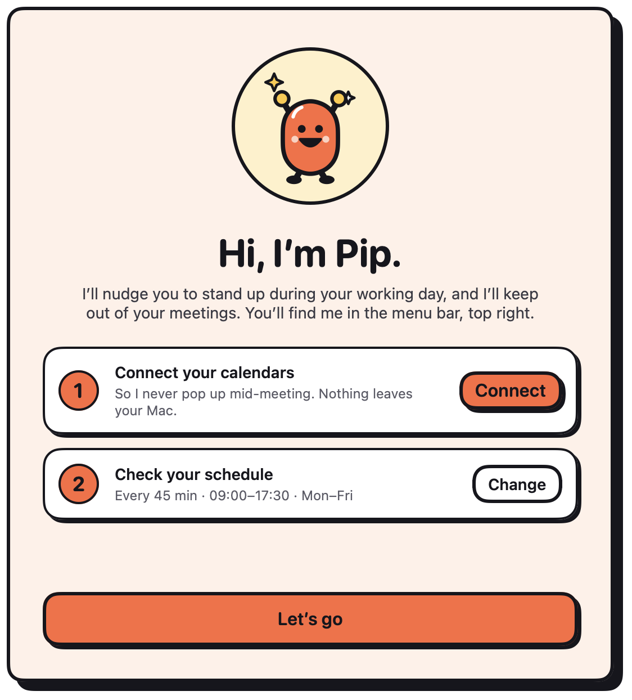
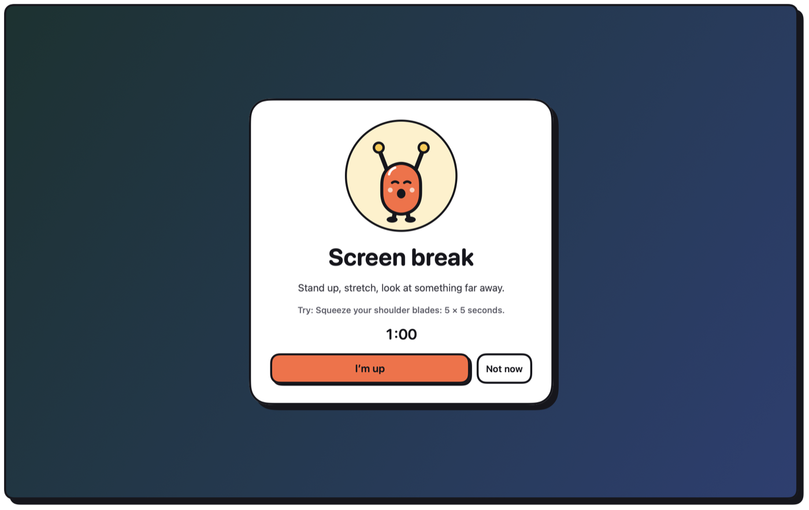
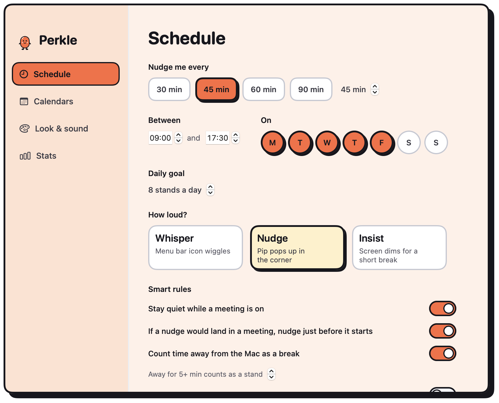
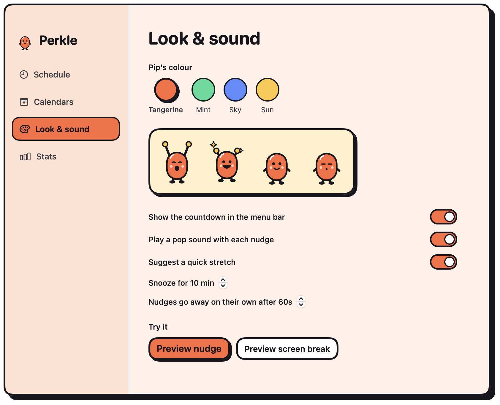

<p align="center">
  
</p>

<p align="center">
  
  
  
  
  <br>
  
  
  
  
</p>

<p align="center">
  <b>Your chair is lovely.</b>
  <br>
  <b>Pip would still like you to leave it now and then.</b>
</p>

---

## Meet Pip

Pip is a small, glossy, slightly bossy jelly bean who lives in your menu bar.
Every 45 minutes or so (you pick), Pip pops up in the corner and asks you to stand.
Pip reads your calendars first, so you never get a nudge halfway through a meeting.
Instead, Pip catches you just before the meeting starts, or a minute after it ends.

<p align="center">
  
  <br>
  <sub><i>Idle, stretching, cheering and sleepy. Pip is drawn entirely in code, so it stays crisp at any size.</i></sub>
</p>

## What it looks like

<table>
  <tr>
    <td width="42%" valign="top" align="center">
      
      <br>
      <sub><b>The menu bar dropdown.</b> Countdown, today's stands and what's coming up.</sub>
    </td>
    <td width="58%" valign="top" align="center">
      
      <br>
      <sub><b>A nudge.</b> It slides into the corner and never steals your keyboard.</sub>
      <br><br>
      
      <br>
      <sub><b>First launch.</b> Two steps and you're done.</sub>
    </td>
  </tr>
</table>

<p align="center">
  
  <br>
  <sub><b>Insist mode.</b> For when a polite nudge isn't enough: the screen dims for a short break.</sub>
</p>

<table>
  <tr>
    <td align="center"><br><sub><b>Schedule.</b> Interval, working hours, days and smart rules.</sub></td>
    <td align="center"><br><sub><b>Look &amp; sound.</b> Four colours for Pip, and the whole app follows.</sub></td>
  </tr>
</table>

## How Pip decides when to nudge

| Situation | What Pip does |
|---|---|
| You've been sitting for *N* minutes (45 by default) | Nudges you, but only within your working hours and days |
| The nudge would land in a meeting and you've been sitting a while | Comes about **2 minutes before** the meeting starts |
| The nudge would land in a meeting otherwise | Comes about **1 minute after** it ends, skipping back-to-back meetings |
| You lock the screen, sleep the Mac or go idle for 5+ minutes | Counts it as a stand and restarts the clock |
| You ignore a nudge | It leaves on its own after 60 seconds and asks again after the snooze time |

Pick how loud Pip gets:

- **Whisper**: the menu bar icon wiggles.
- **Nudge**: a card in the corner that never takes the keyboard from whatever you're typing in.
- **Insist**: the screen dims for a short break.

## Run it

1. You need **macOS 14 (Sonoma) or later** and **Xcode 15 or later**.
2. Clone the repo and open `Perkle.xcodeproj`.
3. Press **⌘R**. Pip appears in the menu bar (top right). There's no Dock icon.
4. On first launch a welcome window opens. Click **Connect** and allow calendar access.

If Xcode shows a signing error, click the **Perkle** target, open **Signing & Capabilities** and pick your Apple ID under **Team**.
The project is set to "Sign to Run Locally", which normally needs no team.

Prefer the terminal?

```sh
xcodebuild -project Perkle.xcodeproj -scheme Perkle -configuration Debug -derivedDataPath build build
open build/Build/Products/Debug/Perkle.app
```

## Google and work calendars

Pip reads every calendar your Mac knows about.
To add more, go to **System Settings › Internet Accounts**:

- **Google**: add your Google account and turn on Calendars.
- **Outlook / Microsoft 365 (work)**: add a **Microsoft Exchange** account and turn on Calendars.

They then show up under **Perkle Settings › Calendars**, where you can switch individual calendars off.
If your company blocks Exchange sign-in on personal Macs, ask IT, or subscribe to your work calendar in Calendar.app instead.

Pip ignores all-day events, events marked "free", cancelled events and invitations you've declined.

## What's inside

| File | What it does |
|---|---|
| `MainApp.swift` | App entry point and menu bar item |
| `AppState.swift` | Timer, idle/sleep detection, actions, everything the screens show |
| `Scheduler.swift` | Pure logic: when the next nudge should be |
| `CalendarService.swift` | Reads events through EventKit |
| `WindowManager.swift` | Floating nudge panel, full-screen break, Settings and welcome windows |
| `NudgeView.swift` | The corner nudge and the full-screen break |
| `MenuPopoverView.swift` | The menu bar dropdown |
| `SettingsView.swift` | Schedule, Calendars, Look & sound, Stats |
| `WelcomeView.swift` | First-run window |
| `PipView.swift` | Pip, drawn in code (4 poses), plus the menu bar icon |
| `Theme.swift` | The "Sticker" look: colours, outlines, hard shadows, buttons, toggles |
| `Models.swift` | Settings, stand log, wording and the app name |

## Renaming

The name appears in three places:

1. `AppInfo.name` in `Models.swift`.
2. The bundle ID `com.example.perkle`: change it in the target's **Signing & Capabilities**.
3. The display name: target › **Build Settings** › "Bundle Display Name".

## Notes

- Headlines use SF Pro Rounded, which ships with macOS, instead of Fredoka. To use Fredoka, add its .ttf files to the target and swap `Theme.display`.
- With "Sign to Run Locally", macOS may ask for calendar permission again after some rebuilds. Signing with your own team avoids this.
- Settings and stats live in UserDefaults on this Mac only. Nothing is sent anywhere.

<p align="center">
  <br>
  <sub>Made for people who forget they have legs.</sub>
</p>
